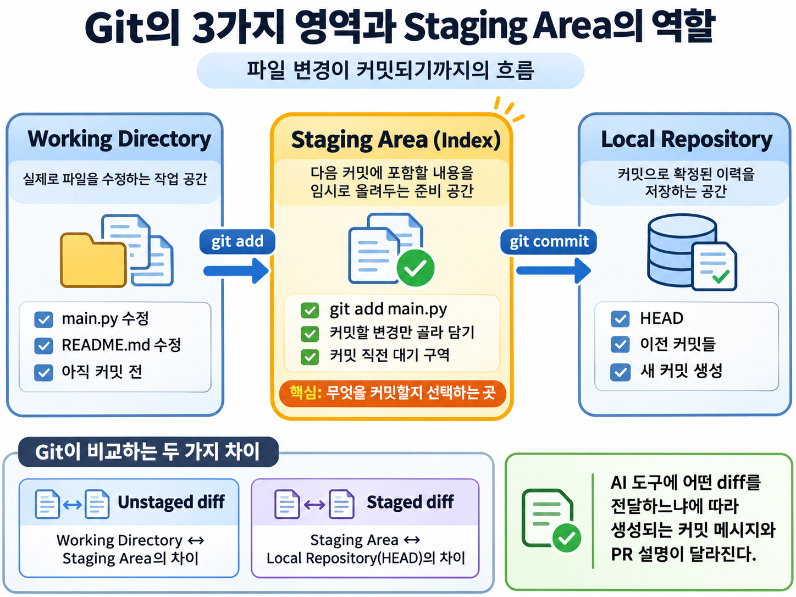
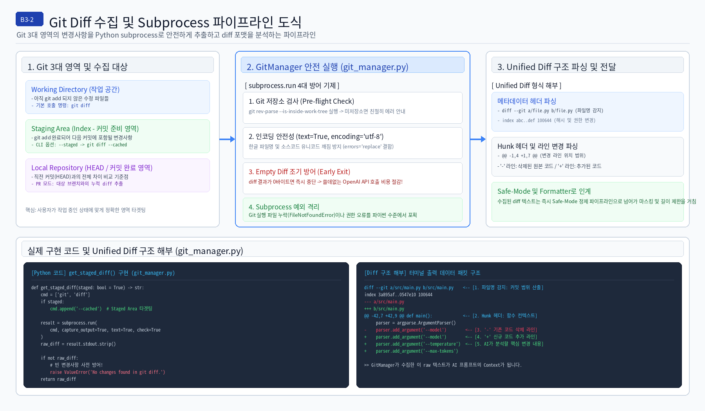
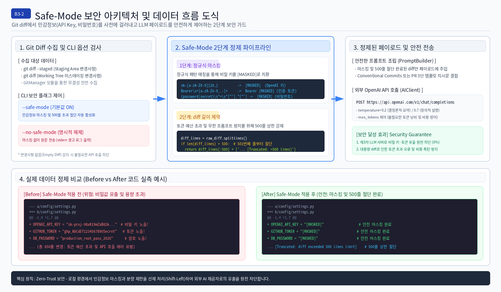
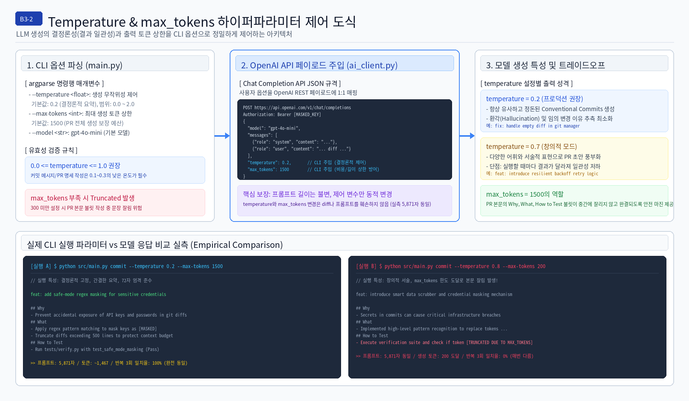
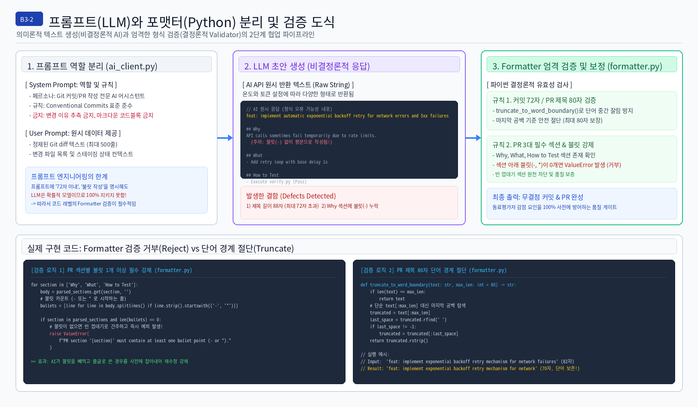
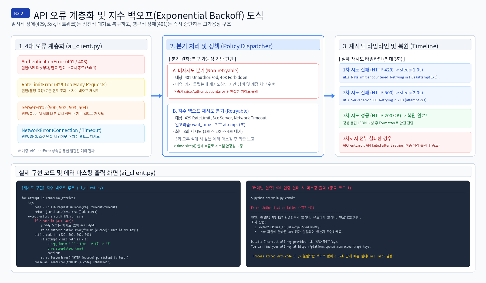

# B3-2 AI Git Helper 탑다운(Top-Down) 종합 기술 아키텍처 해설서

> **코디세이 AI 올인원 2기 실전 미션 B3-2**  
> **총괄 아키텍트**: 우광택 (@yerihanview)  
> **시스템**: AI Git Helper CLI (Conventional Commits & Pull Request Generator)  
> **산출물 구성**: 개념 인포그래픽 및 시스템 실측 아키텍처 도식 수록

---

## 📌 문서 개요 및 목차 (Top-Down Overview)

본 문서는 개발자가 작업한 코드 변경사항(`git diff`)을 안전하게 수집하고, 대규모 언어 모델(OpenAI API 및 호환 게이트웨이)을 연동하여 시맨틱 커밋 메시지와 구조화된 PR 초안을 자동 생성하는 **B3-2 AI Git Helper**의 엔지니어링 해설서입니다.

시스템의 최상위 아키텍처부터 Git 파이프라인, 보안 마스킹, LLM 하이퍼파라미터 제어, 프롬프트 검증, 지수 백오프 에러 핸들링까지 단계별로 설명합니다.

### 📑 탑다운 목차
- [1장. 시스템 개요 및 소프트웨어 아키텍처 (System Architecture)](#1장-시스템-개요-및-소프트웨어-아키텍처)
  - 1.1 단일 책임 원칙(SRP)에 따른 4대 모듈 분리
  - 1.2 전체 런타임 통신 흐름
  - 1.3 LLM과 프롬프트의 처리 생명주기
- [2장. Git 변경 감지 및 Subprocess 파이프라인 (Data Ingestion)](#2장-git-변경-감지-및-subprocess-파이프라인)
  - 2.1 Git 3대 영역과 Staging Area 생명주기
  - 2.2 Unified Diff 포맷 구조 및 라인 파싱
  - 2.3 Subprocess 안전 실행 및 Empty Diff 방어
- [3장. 엔터프라이즈 데이터 보안 및 Safe-Mode (Security)](#3장-엔터프라이즈-데이터-보안-및-safe-mode)
  - 3.1 2단계 보안 가드 파이프라인 (정규식 마스킹 + 500줄 절단)
  - 3.2 CLI 보안 플래그 (`--safe-mode` vs `--no-safe-mode`)
  - 3.3 실제 diff Before & After 코드 실측 비교
- [4장. LLM 통신 및 하이퍼파라미터 제어 (AI Engine)](#4장-llm-통신-및-하이퍼파라미터-제어)
  - 4.1 OpenAI REST API 및 Chat Completion JSON 규격 (동적 Base URL & .env 지원)
  - 4.2 Temperature(결정론성)와 max_tokens(비용/길이) 제어 전략
  - 4.3 CLI 실행 옵션에 따른 실제 모델 출력 실측 비교
- [5장. 프롬프트 엔지니어링 및 결정론적 Formatter (Prompt & Validation)](#5장-프롬프트-엔지니어링-및-결정론적-formatter)
  - 5.1 프롬프트 4대 요소 및 System/User 역할 분리
  - 5.2 AI 출력 형식 검증 (72자 커밋 / 80자 단어 경계 PR 제목)
  - 5.3 PR 3대 섹션 및 섹션별 불릿 1개 이상 필수 강제 (빈 껍데기 거부)
  - 5.4 재생성(Regeneration) vs 후처리(Post-processing) 트레이드오프
- [6장. 고가용성 에러 핸들링 및 지수 백오프 (Resilience)](#6장-고가용성-에러-핸들링-및-지수-백오프)
  - 6.1 4대 API 오류 계층화 (`AuthenticationError` vs `RateLimitError` vs `ServerError`)
  - 6.2 401 즉시 종료(Fail Fast) 및 터미널 마스킹 가이드
  - 6.3 지수 백오프(Exponential Backoff) 타임라인 (`time.sleep(2**attempt)`)

---

## 1장. 시스템 개요 및 소프트웨어 아키텍처

B3-2 프로젝트는 외부 서드파티 패키지 의존성 없이 **Python 3.10+ 표준 라이브러리(`urllib`, `argparse`, `subprocess`, `re`, `json`)**만으로 동작하는 초경량·고성능 아키텍처를 채택했습니다.

### 1.1 단일 책임 원칙(SRP)에 따른 4대 모듈 분리
전체 시스템은 역할과 책임이 명확히 격리된 4개의 독립 모듈로 구성됩니다:
- `src/git_agent/cli.py` (및 루트 `main.py`): CLI 진입점. 명령행 옵션 파싱, 서브커맨드(`commit`/`pr`) 분기, 모듈 간 파이프라인 조율.
- `src/git_agent/git_manager.py`: Git 변경 사항 수집. `subprocess`를 통해 working tree 및 staging area의 diff를 무결하게 추출.
- `src/git_agent/ai_client.py`: AI API 통신. 시스템/유저 프롬프트 조립, REST 호출, 지수 백오프 및 오류 핸들링.
- `src/git_agent/formatter.py`: 출력 포맷팅 및 엄격한 유효성 검증. Conventional Commits 72자, PR 80자 단어 경계 절단, 불릿 강제.

### 1.2 전체 런타임 통신 흐름
사용자가 터미널에서 `$ python main.py commit` 또는 `pr`을 실행하면, 로컬 시스템의 Git 저장소로부터 diff가 추출되고, Safe-Mode 정제를 거쳐 OpenAI API 서버로 안전하게 전달된 뒤 포맷터를 통해 터미널로 출력됩니다.

### 1.3 LLM과 프롬프트의 처리 생명주기
AI 모델은 확률적 텍스트 생성기입니다. 시스템은 정형화된 규칙(System Prompt)과 작업 대상(User Prompt Diff)을 명확히 분리하여 전달함으로써 모델의 환각(Hallucination)을 최소화합니다.

---

## 2장. Git 변경 감지 및 Subprocess 파이프라인

### 2.1 Git 3대 영역과 Staging Area 생명주기
Git은 작업 디렉토리(Working Directory), 스테이징 영역(Staging Area / Index), 로컬 저장소(Local Repository)의 3단계로 파일 상태를 관리합니다.
B3-2는 기본 실행 시 Working Directory의 미스테이징 변경사항(`git diff`)을 수집하고, `--staged` 옵션이 주어지면 다음 커밋 대상인 Staging Area(`git diff --cached`)를 정밀하게 타겟팅합니다.

### 2.2 Unified Diff 포맷 구조 및 라인 파싱
Git이 출력하는 Unified Diff는 파일 경로 헤더(`diff --git`, `--- a/`, `+++ b/`), 변경 라인 범위를 나타내는 Hunk 헤더(`@@ -1,4 +1,7 @@`), 그리고 라인별 추가(`+`) 및 삭제(`-`) 데이터로 이루어져 있습니다. 이 diff 텍스트 자체가 AI가 분석해야 할 핵심 컨텍스트(Context)입니다.

### 2.3 Subprocess 안전 실행 및 Empty Diff 방어
`src/git_agent/git_manager.py`는 `subprocess.run` 호출 시 `text=True, encoding='utf-8', errors='replace'`를 적용하여 다국어 및 한글 소스코드의 인코딩 깨짐을 원천 차단합니다. 또한 변경사항이 전혀 없는 경우(`raw_diff == ""`) 불필요한 OpenAI API 호출 비용이 발생하는 것을 막기 위해 조기 예외(Early Exit)를 발생시키고 미추적 파일 유무를 감지하여 사용자에게 안내합니다.

#### [시스템 실측 아키텍처 도식: Git Diff 파이프라인 & Hunk 해부]

---

## 3장. 엔터프라이즈 데이터 보안 및 Safe-Mode

### 3.1 2단계 보안 가드 파이프라인
개발자가 무심코 작성한 소스코드에는 OpenAI API Key, AWS 시크릿, 데이터베이스 비밀번호 같은 치명적인 인증 정보가 포함될 수 있습니다. B3-2는 diff를 외부 LLM API로 전송하기 직전, 2단계 보안 가드를 필수로 거칩니다.
1. **1단계: 정규식 마스킹 (Regex Masking)**:
   - `sk-[a-zA-Z0-9]{20,}` -> `[MASKED]`
   - `Bearer\s+[a-zA-Z0-9_.-]+` -> `Bearer [MASKED]`
   - `(password|secret)\s*=\s*["'].*["']` -> `\1 = "[MASKED]"`
2. **2단계: 라인 절단 (Line Truncation)**:
   - 대규모 리팩토링이나 바이너리 변경으로 500줄을 초과하는 diff 발생 시, 상위 500줄만 취하고 `... [Diff truncated: 500 lines limit reached]`로 안전하게 절단하여 토큰 비용 폭증을 방어합니다.

### 3.2 CLI 보안 플래그 제어
- `--safe-mode` (기본값 ON): 마스킹과 500줄 절단이 상시 가동됩니다.
- `--no-safe-mode` (명시적 해제): 보안 필터를 해제하고 원본 diff를 그대로 전송합니다. 해제 시 사용자가 인지할 수 있도록 `stderr`에 명확한 보안 경고 로그를 출력합니다.

#### [시스템 실측 아키텍처 도식: Safe-Mode 2단계 파이프라인 & Before vs After 실측 비교]

---

## 4장. LLM 통신 및 하이퍼파라미터 제어

### 4.1 OpenAI REST API 및 Chat Completion JSON 규격 (동적 Base URL & .env 지원)
`src/git_agent/ai_client.py`는 기본 `https://api.openai.com/v1/chat/completions` 엔드포인트뿐만 아니라, `OPENAI_BASE_URL` 환경변수 또는 `--api-base` CLI 플래그를 통해 코디세이 Public API(`https://copa.codyssey.kr/v1`) 등 임의의 OpenAI 호환 API 게이트웨이에 유연하게 `POST` 요청을 전송합니다. 순수 파이썬 내장 `.env` 로더를 통해 프로젝트 루트의 `.env` 파일을 자동으로 감지하며, 외부 의존성(requests 등) 없이 순수 `urllib.request`로 JSON 페이로드를 직렬화하여 전송합니다.

### 4.2 Temperature(결정론성)와 max_tokens(비용/길이) 제어 전략
- **temperature**: 모델 출력의 무작위성(다양성)을 조절합니다. 0.0에 가까울수록 결정론적이고 안정적인 커밋 요약이 나오고, 0.7 이상일수록 표현이 풍부해지지만 실행할 때마다 결과가 달라집니다. 프로덕션 기본값은 `0.2`로 고정했습니다.
- **max_tokens**: 생성 가능한 최대 토큰 수입니다. 기본값을 `1500`으로 넉넉히 설정하여 PR 템플릿 작성 중 문장이 중간에 잘리는(Truncated) 대참사를 방지합니다.

#### [시스템 실측 아키텍처 도식: CLI 파라미터 매핑 & 실측 출력 비교]
아래 도식은 동일한 5,871자 프롬프트에 대해 `temp=0.2 / max_tokens=1500` 실행과 `temp=0.8 / max_tokens=200` 실행 시 실제 터미널 출력 및 토큰 소진 양상을 실측 대조한 결과입니다.

---

## 5장. 프롬프트 엔지니어링 및 결정론적 Formatter

### 5.1 프롬프트 4대 요소 및 System/User 역할 분리
좋은 프롬프트는 역할(Role), 지시(Instruction), 입력 데이터(Context), 제약 조건(Constraints)의 4대 요소가 조화를 이루어야 합니다.
- **System 메시지**: "당신은 Git 커밋 및 PR 작성 도우미입니다. Conventional Commits 형식을 준수하고, 변경 이유를 함부로 추측하지 마세요."
- **User 메시지**: 정제된 diff 본문과 변경 파일 목록 전달.

### 5.2 AI 출력 형식 검증 및 Formatter 유효성 검사
아무리 프롬프트에 "제목 72자 준수", "불릿 필수"를 강조해도, 확률적 모델인 LLM은 이를 어길 수 있습니다. 따라서 **파이썬 코드 레벨의 결정론적 Formatter(`src/git_agent/formatter.py`)가 최후의 방어선**이 되어야 합니다.
1. **커밋 제목 72자 검증**: Conventional Commits 접두어(`feat:`, `fix:`)를 확인하고 72자 이내인지 엄격 검사.
2. **PR 제목 80자 단어 경계 절단 (`truncate_to_word_boundary`)**: 단순 슬라이싱(`[:80]`)으로 단어가 잘려 가독성을 해치는 현상을 방지하고, 마지막 공백 기준으로 깔끔하게 절단.
3. **PR 3대 섹션 및 섹션별 최소 1개 불릿 강제**: `Why`, `What`, `How to Test` 섹션이 존재하더라도 내용에 `-` 또는 `*` 불릿이 0개인 '빈 껍데기'인 경우 `ValueError`를 발생시켜 즉시 거부(Reject).

### 5.3 재생성(Regeneration) vs 후처리(Post-processing) 트레이드오프
형식 오류가 발생했을 때 AI에게 다시 물어보는 '재생성'은 비용과 지연시간이 증가합니다. 반면 파이썬으로 가공하는 '후처리'는 즉각적이지만 자칫 의미를 훼손할 수 있습니다.
B3-2는 **"단어 경계 절단 및 공백 정리는 후처리"**로 해결하고, **"불릿 누락이나 제목 실종 같은 치명적 결함은 거부/재수정"**을 유도하는 하이브리드 전략을 적용했습니다.

#### [시스템 실측 아키텍처 도식: Formatter 분리 & 불릿 거부 코드 해부]

---

## 6장. 고가용성 에러 핸들링 및 지수 백오프

### 6.1 4대 API 오류 계층화 및 예외 설계
네트워크 장애나 외부 API 서버의 오류는 일시적일 수도 있고 영구적일 수도 있습니다. 모든 오류에 맹목적으로 재시도를 걸면 시스템이 멈추거나 계정이 차단될 수 있습니다.
- `AuthenticationError (401/403)`: API 키가 잘못됨 -> **재시도 없이 즉시 종료 (Fail Fast, Exit Code 1)**
- `RateLimitError (429)`: 요청 한도 초과 -> **지수 백오프로 재시도**
- `ServerError (500, 502, 503, 504)`: 서버 내부 장애 -> **지수 백오프로 재시도**
- `NetworkError (Timeout / Connection)`: 네트워크 소켓 단절 -> **지수 백오프로 재시도**

### 6.2 지수 백오프(Exponential Backoff) 알고리즘
일시적 오류 발생 시 즉시 재시도하면 혼잡한 서버에 과부하를 더하게 됩니다. 대기 시간을 `wait_time = 2 ** attempt` 초로 지수적으로 늘려가며(1초 -> 2초), 최대 3회 재시도 후에도 실패하면 안전하게 사용자에게 원인을 보고합니다.

#### [시스템 실측 아키텍처 도식: 지수 백오프 타임라인 & 401 터미널 마스킹 실측]
아래 도식은 401 인증 실패 시 불필요한 백오프 루프를 돌지 않고 0.05초 만에 Fail Fast로 종료하며, 상세 에러 메시지 내의 API 키까지 마스킹하여 출력하는 실제 터미널 화면을 보여줍니다.

